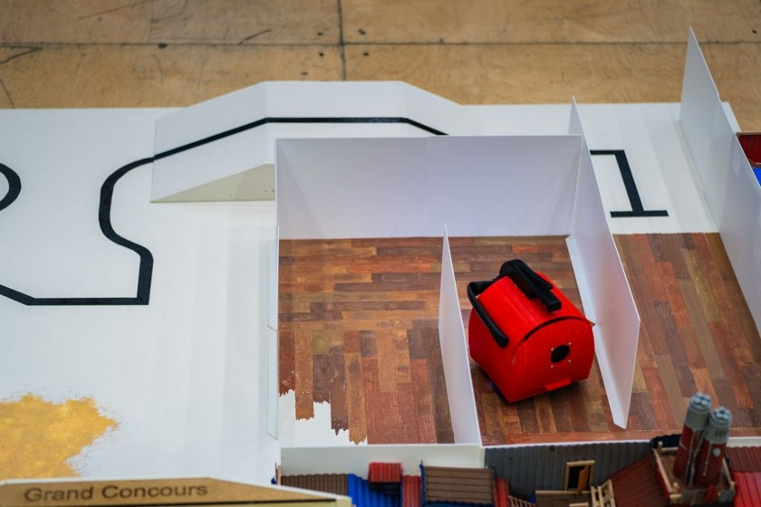
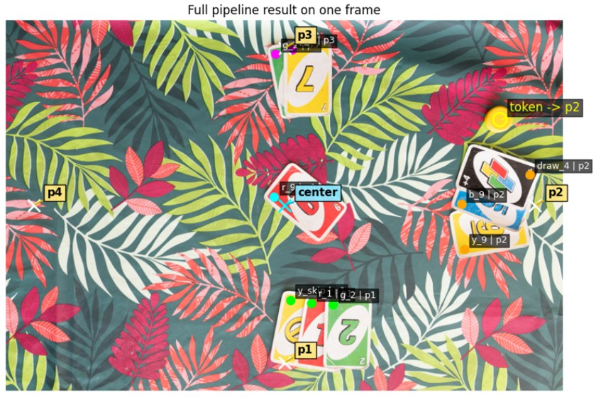

# Evan Ayoub

I’m a Robotics MSc student at EPFL with a minor in Data Science. I write software for robot perception and control, from recognizing objects in camera frames to steering a robot on a physical course.

[Portfolio](https://aiglegivree.github.io/evanayoub/) · [CV](https://aiglegivree.github.io/evanayoub/assets/cv/CV_2026_en.pdf) · [LinkedIn](https://www.linkedin.com/in/evan-joseph-gerard-ayoub)

## Selected public code

### Valobot

Our EPFL Robopoly robot follows lines and navigates corridors using a single camera. I worked on controller integration and tuned the line follower using recorded runs. The controller shows how an error measured in the image becomes a command for each wheel.

[Line-following controller](https://github.com/aiglegivree/Valobot/blob/main/Code_fsm_v1/controller.py)

### Autonomous drone navigation

I developed a gate-navigation controller in Webots, then worked with our EPFL flight team to transfer it to a Crazyflie. The simulation controller and the hardware flight script are in separate course forks.

[Webots controller](https://github.com/aiglegivree/Aerial/blob/main/controllers/main/assignment/my_assignment.py) · [Hardware flight script](https://github.com/aiglegivree/Aerial_Hardware/blob/master/myassignement/hardware_lap1.py)

### UNO Vision Challenge

Our EPFL group built a pipeline that takes a photo of a game, recognizes the cards, and assigns them to players. The main script ties the stages together. The results notebook shows how the pipeline performed.

[Pipeline entry point](https://github.com/aiglegivree/IAPR_gr69/blob/main/project/final_group_69_gr_69/main.py) · [Results notebook](https://github.com/aiglegivree/IAPR_gr69/blob/main/project/final_group_69_gr_69/results_notebook.ipynb)

### Copycat Portfolios

Can investors beat the market by copying the stock trades that members of the U.S. Congress publicly disclose? Our EPFL Applied Data Analysis team investigated that question in a notebook and built an interactive site to present the results.

[Analysis notebook](https://github.com/epfl-ada/Congressional-Stock-Trading-Behavior/blob/main/results.ipynb) · [Team repository](https://github.com/epfl-ada/Congressional-Stock-Trading-Behavior) · **[Interactive demo](https://ada-2025-project-adaptateurusbversu.vercel.app/)**

