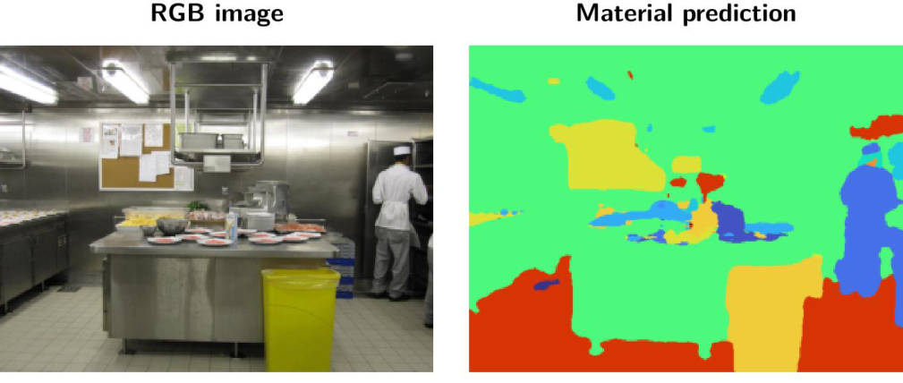

# Evan Ayoub

I’m a Robotics MSc student at EPFL with a minor in Data Science. I build vision and control systems that help robots recognize objects, navigate, and manipulate what they see.

[Portfolio](https://aiglegivree.github.io/evanayoub/) · [CV](https://aiglegivree.github.io/evanayoub/assets/cv/CV_2026_en.pdf) · [LinkedIn](https://www.linkedin.com/in/evan-joseph-gerard-ayoub)

## Selected projects

<table>
<tr>
<td width="230"></td>
<td><strong>Sisyphus · 1st Place, Leukerbad Robotics Hackathon 2026</strong> We built a low-cost, modular robot for urban services. Its first application picks up envelopes, matches each recipient’s name to a mailbox, and delivers the mail. We won the Grand Final and the Autonomous Urban Services track. <a href="https://aiglegivree.github.io/evanayoub/assets/projects/sisyphus/demo.mp4">Watch the delivery run</a></td>
</tr>
<tr>
<td width="230"></td>
<td><strong>Vision-guided rover manipulation · EPFL Xplore</strong> Developing a system for the European Rover Challenge that detects and tracks target objects and controls a rover-mounted arm for pick-and-place tasks.</td>
</tr>
<tr>
<td width="230"></td>
<td><strong>Material classification and segmentation in images · DISAL, EPFL</strong> Trained a ConvNeXt model with sparse annotations to recognize materials in everyday scenes. Used structured pruning to reduce model size for devices with limited compute.</td>
</tr>
<tr>
<td width="230"></td>
<td><strong>Copycat Portfolios</strong> Can investors beat the market by copying the stock trades that members of the U.S. Congress publicly disclose? <strong><a href="https://ada-2025-project-adaptateurusbversu.vercel.app/">Explore the interactive demo</a></strong> &middot; <a href="https://github.com/epfl-ada/Congressional-Stock-Trading-Behavior">Team repository</a></td>
</tr>
</table>

## More project code

- [UNO Vision Challenge](https://github.com/aiglegivree/IAPR_gr69#uno-vision-challenge) · Card recognition and player attribution
- [Autonomous drone navigation](https://github.com/aiglegivree/Aerial#drone-gate-navigation) · Webots controller and [Crazyflie flight tests](https://github.com/aiglegivree/Aerial_Hardware#crazyflie-flight-tests)

**Tools I use** · Python, C/C++, PyTorch, OpenCV, MATLAB, Webots
